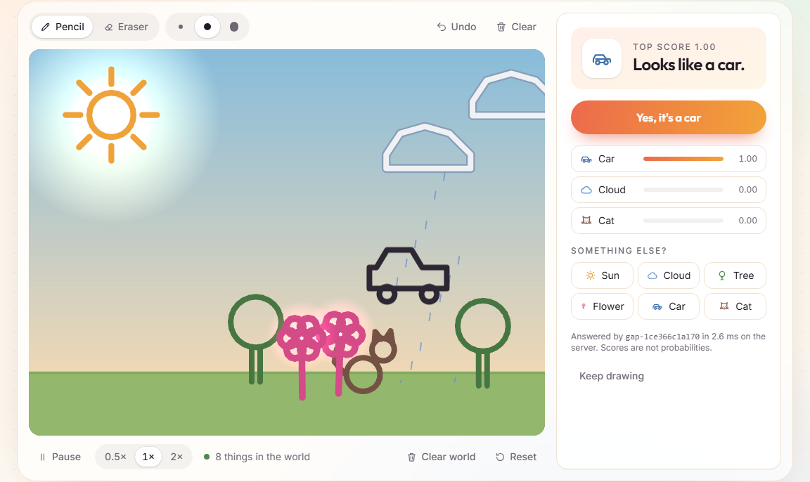

# Doodleverse

Draw it. Bring it to life.

Draw a sun, a cloud, a tree, a flower, a car, or a cat. A CNN trained on Quick, Draw! names it, you confirm, and it joins a small animated world: suns light it, a tapped cloud rains, trees and flowers grow in the rain, cars drive and bump, and cats wander and run from cars.

Live at [doodleverse-alpha.vercel.app](https://doodleverse-alpha.vercel.app), with the model served from AWS. [How it is deployed](docs/deploy.md).



Sketches are named with a model trained on the [Quick, Draw!](https://github.com/googlecreativelab/quickdraw-dataset) dataset by Google Creative Lab, used under [CC BY 4.0](NOTICE).

## How it works

The browser sends strokes, not pixels. A FastAPI service rasterizes them with the same 28×28 contract the model was trained on, runs the TensorFlow CNN, and returns the class, its score, the top three, the model version, and an uncertainty flag. A confident answer is confirmed with one tap. An uncertain one is never chosen for you. The world, PixiJS with Matter.js for the cars, runs in the browser. [Architecture](docs/architecture.md).

## Results

- Test split, scored once after the model, the gate, and the rasterizer were frozen: 0.950 accuracy and 0.950 macro-F1 over 3,600 drawings. Logistic regression on the same pixels reached 0.831 validation macro-F1.
- The uncertainty gate answers 86.8% of test drawings without asking, and 0.991 of those answers are right.
- On 3,000 held-back drawings, strokes through this project's rasterizer score 0.947, against 0.949 for Google's own bitmaps of the same strokes.
- Warm `/predict`: 3.10 ms p50 on a local server, 26.18 ms p50 to the deployed API from the same laptop.
- 165 fps with 24 entities in headed Chromium, with the main thread 9.0% busy.

More in the [model card](docs/model-card.md), [experiments](docs/experiments.md), [benchmarks](docs/benchmark-results.md), and [API](docs/api.md).

## Limitations

- Six classes. A drawing of anything else still gets one of the six.
- The model learned from Google's renders of the drawings. The rasterizer gap was measured on Google's simplified strokes, not on live pointer input.
- One training run, one seed, one split. Scores are softmax outputs, not calibrated probabilities.
- Latency and frame rate come from one laptop (Ryzen 9 7945HX, RTX 4080 Laptop GPU) and will differ elsewhere.

## Run it

```bash
python -m venv .venv
source .venv/bin/activate        # Windows: .venv\Scripts\activate
pip install -e ".[dev]"
python -m doodleverse.data.prepare          # download six classes, write the split
python -m doodleverse.training.compare      # train the baseline and the CNN
python -m doodleverse.training.select_cnn   # train the narrow CNN, keep one
python -m doodleverse.training.analyze      # validation mistakes and the uncertainty gate
python -m doodleverse.training.skew         # score held-out strokes through the rasterizer
python -m doodleverse.training.export       # artifacts/model: model.keras and sidecar.json
python -m doodleverse.training.model_card   # docs/model-card.md from the export and the runs
uvicorn doodleverse_api.main:app            # serve artifacts/model on :8000
pytest
```

```bash
cd apps/web
npm ci
npm run dev                  # talks to the API on :8000; NEXT_PUBLIC_MOCK_INFERENCE=1 fakes it instead
npm test && npm run lint
npx playwright install chromium
npm run e2e                  # draw / recognize / confirm / rain / reset against a mocked /predict
```

Or both in Docker, once `artifacts/model` exists:

```bash
docker compose -f infra/docker-compose.yml up --build
```

Benchmarks write JSON to [bench/results](bench/results), with the machine and versions next to the numbers:

```bash
python -m bench.api --container   # model load, warm /predict p50 and p95, container memory and image size
cd apps/web && npm run bench      # frame rate in headed Chromium, empty and with 24 entities
python -m bench.report            # docs/benchmark-results.md
```

The AWS and Vercel deploy is [infra/aws](infra/aws), with the runbook in [docs/deploy.md](docs/deploy.md).

[CI](.github/workflows/ci.yml) runs ruff, pytest, the typecheck, ESLint, Vitest, Playwright against a mocked `/predict`, and both image builds. It does not train.

The test split has been scored once, and [ml/splits/v1.test-scored.json](ml/splits/v1.test-scored.json) keeps it that way.
